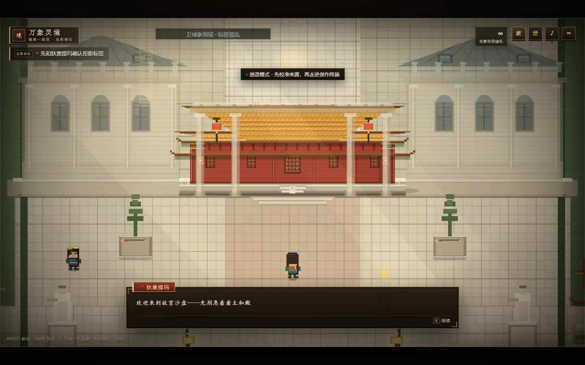
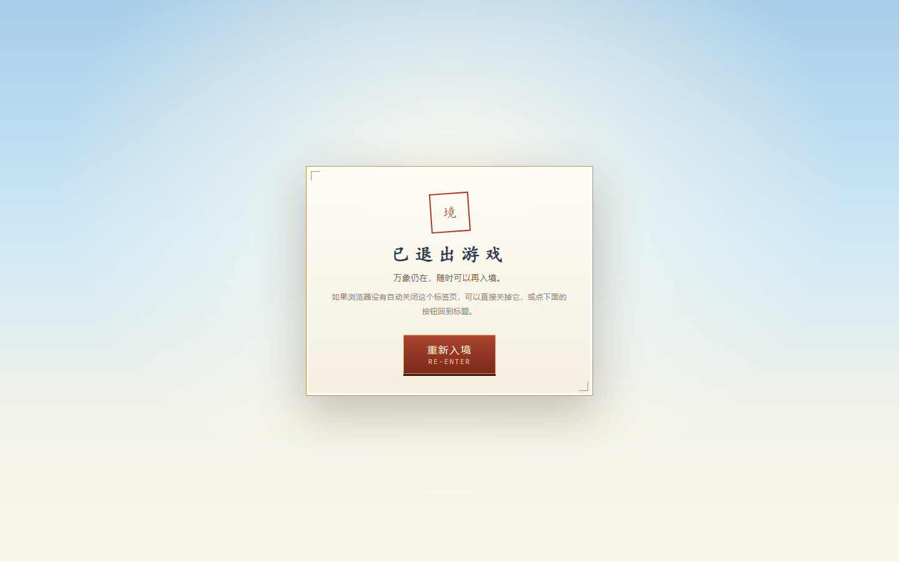
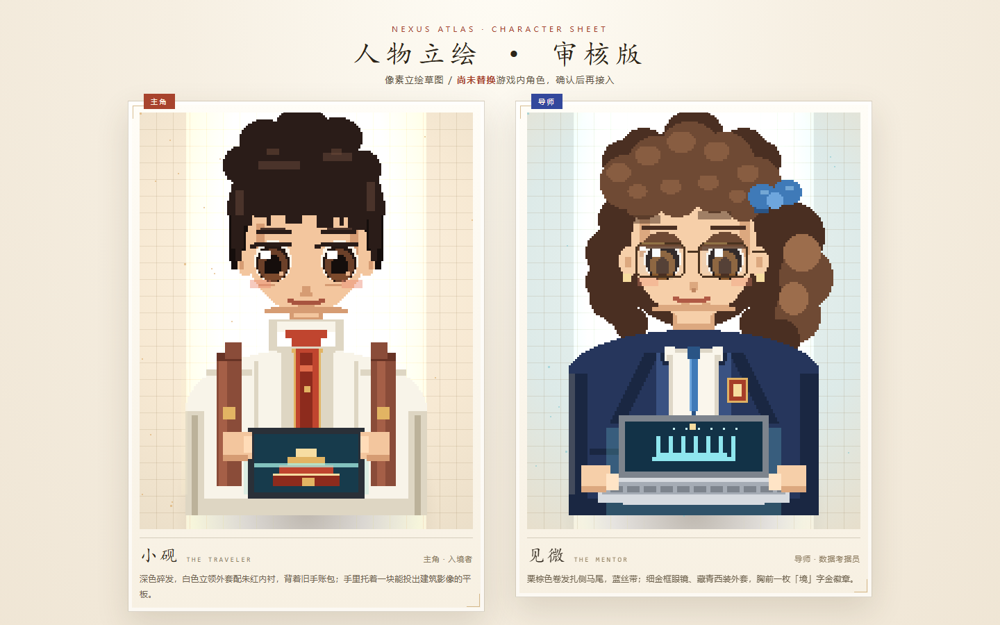
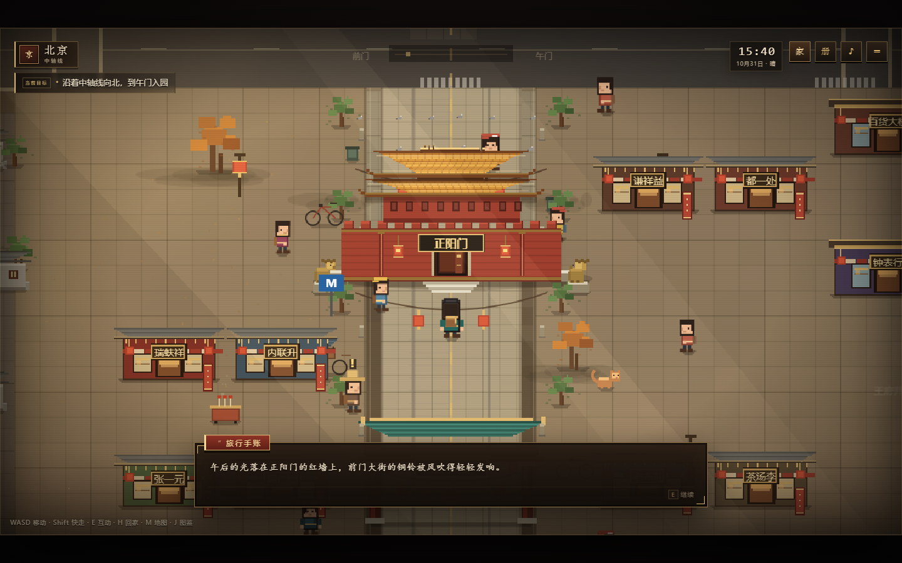

# 万象灵境


一个 **640 × 360 像素风** 的文化试验场：从正阳门出发，沿北京中轴线走到午门，安检入园，在故宫里替老赵找齐打铁花的材料，等天黑之后亲手泼出一炉铁水；也可以转入 **「万象灵境 · 雅典—故宫」** 数字沙盘，在故宫与卫城的投影之间校准来源、走进创作终端。

全部画面由 Canvas 程序化绘制，没有外部图片素材；游戏逻辑为原生 JavaScript，无构建步骤。

---

## 游戏入口

标题页只保留四个入口：

| 入口 | 作用 |
| --- | --- |
| **故事模式** | 北京中轴线 → 午门安检 → 故宫探索 → 入夜打铁花（原「紫禁城 · 铁火」主线） |
| **继续游戏** | 读取本机存档，回到上次的场景与任务进度 |
| **创造模式** | 进入「万象灵境 · 雅典—故宫」数字沙盘：双档案、非遗小游戏、来源校准台与创作终端 |
| **退出游戏** | 存档后退出；若浏览器不允许脚本关闭标签页，会停在退出画面，可「重新入境」回到标题 |

独立的 **「雅典 · 卫城」** 游戏仍在 `athens-city/` 目录里单独运行，不再占用标题页入口。

---

## 本仓库包含两个游戏

| 游戏 | 目录 | 端口 | 一句话 |
| --- | --- | --- | --- |
| **万象灵境** | 根目录 | 8123 | 故事模式：北京中轴线 → 故宫打铁花；创造模式：雅典—故宫数字沙盘 |
| **[雅典 · 卫城](athens-city/README.md)** | `athens-city/` | 8213 | 希腊卫城：山门入城、卫城探索、点火圣火 |

两个游戏完全独立：各自的 `index.html`、`serve.js`、存档键互不干扰，可以分别运行。

---

## 运行

需要 Node.js 18+。

```bat
双击 start.bat
```

或者手动：

```bash
cd forbidden-city
node serve.js
# 打开 http://127.0.0.1:8123/
```

> 不要直接双击 index.html。页面通过本地静态服务器读取脚本，`file://` 下部分浏览器会限制脚本与存储。

### 网站版（单文件）

`web.html` 是全部 CSS / JS 内联后的单文件版本，**可以直接双击用浏览器打开**，也可以上传到任意静态托管（GitHub Pages、Netlify、Cloudflare Pages 等）。

修改源码后重新生成：

```bash
node tools/build-web.mjs   # 或 npm run build:web
# 生成 web.html
```

当前开发服务器也会直接提供它：`http://127.0.0.1:8123/web.html`

---

## 操作

| 按键 | 作用 |
| --- | --- |
| WASD / 方向键 | 移动 |
| Shift | 快走 |
| E | 互动、对话继续 |
| H | 回家 / 离开大厅 |
| M | 打开 / 关闭地图（北京中轴线图、故宫导览图、万象灵境图） |
| J | 旅行图鉴 |
| Esc | 暂停菜单 |
| 空格 / 回车 / E | 打铁花小游戏起炉、锁定火力、泼铁 |
| 空格 / 点击画面 | 榫卯 / 大理石非遗小游戏：合拢、下凿 |
| 1 / 2 / 3 · 点击 | 小游戏难度选择：简易 / 困难 / 地狱 |

触屏设备会显示虚拟方向键、互动键与地图键。

---

## 一局怎么走

1. **北京 · 中轴线**
   从正阳门与前门大街出发。可以逛胡同、王府井、北海、天坛、鸟巢、国贸，也可以坐地铁 8 号线跳过一段路。
   目标：沿中轴线向北，到午门。
   右上角的 **「家」按钮**（或按 H）可以随时回到自己的大厅，大厅里有一张合成台和一张修复台；从大厅大门离开会回到刚才的位置。

2. **午门入园**
   走到午门，按 E 与安检员交谈，随后进入“入园安检”：
   - 证件核验
   - 行李安检
   两项通过后，直接进入故宫。

3. **故宫探索**
   穿过内金水桥、太和门、太和殿、乾清宫，一路向北到御花园和神武门。
   和打铁花匠人老赵交谈，替他找齐三样材料：
   - 珍宝馆前的生铁块
   - 御花园的柳木炭
   - 箭亭的柳木勺
   沿途的导览牌、宫猫、游客都可以互动，解锁图鉴。

4. **入夜 · 打铁花**
   材料齐了以后，在神武门广场等到日落。入夜后找老赵，弹窗询问是否现在挑战：
   - 选 **是** → 先选难度（简易 / 困难 / 地狱）→ 开始打铁花（可无限次重玩）
   - 选 **否** → 直接在夜里继续自由探索，想打随时再找老赵
   打铁花本身可按难度变化：难度越高，勺数越少、铁水烧得越快、判定区越窄。

---

## 万象灵境 · 雅典—故宫（独立章节）

标题页新增 **「万象灵境 / NEXUS ATLAS」** 入口。它不影响原来的北京—故宫—打铁花主线，是一张独立的故宫数字沙盘。

- **故事**：雅典学者 **狄奥提玛（Διοτίμα）** 把卫城的建筑与考古数据包接进故宫沙盘，参数过载后，故宫本体没有被替换，但投影和来源标签错位了。玩家在午门内与她确认状况，寻找两份档案。
- **西侧帕特农投影**：卫城档案 · 帕特农东山墙、伊瑞克提翁女像柱、舞乐图瓶画线图。
- **东侧太和殿东庑**：故宫档案 · 简化中轴图。
- **两份档案都要先完成非遗小游戏（收齐后仍可无限次重玩）**：
  - 触碰档案先弹窗询问「是否挑战」：选 **是** → 选难度 → 开始；选 **否** → 直接继续探索。
  - 每次进入小游戏都要先选难度：**简易 / 困难 / 地狱**。难度决定回合数、方向和是否限时（地狱限时，超时重来）。
  - 太和殿东庑 · **榫卯合拢**（中国传统木结构建筑营造技艺）：旋转榫头对准卯口，简易 3 回合、困难 4 回合、地狱 5 回合限时。
  - 帕特农投影 · **大理石凿刻**（提诺斯大理石雕刻技艺）：等凿子对准石纹，三次下凿。
- **中央来源校准台**：双档案投入后播放“来源校准”，把被误标的帕特农山墙归位为“卫城参照层”，并给出宴乐图像的来源卡。
- **校准前后场景会变化**：校准前，卫城石翼压在半透明的投影里；校准后，投影退去，故宫自己的东西庑和红墙金瓦显现，帕特农缩为带正确标签的参照层，场景转为稳定暖光。
- **来源判断**：校准后还要回答三条来源卡问题：误标怎么改、宴乐图像能比到什么程度、丝路图像能证明什么。答错会给出边界解释，可以重试。
- **北侧创作终端**：三条来源判断完成后才会点亮，进入后完成第一境；从南门可以离开灵境。
- 完整走一遍（对话、两处非遗小游戏、校准、三条来源判断、创作终端）大约 **3–5 分钟**。
- **M 键**：查看这座沙盘的羊皮纸导览图。

这张图保留故宫的金瓦红墙、汉白玉御路和门阙序列，把帕特农、女像柱、橄榄树与舞乐瓶画作为**半透明投影层**叠在上面；比较的是空间观念与宴乐图像的功能关系，不声称故宫—卫城存在直接建筑传承或器物交换。

---

## 插件 · 同境异笔（非主线）

标题页与暂停菜单里的 **「同境异笔 / PLUGIN」** 入口，会把一个**独立的小 Demo** 以 iframe 的形式开在游戏之上：

- 它有自己的引擎、地图和存档键（`wanxiang.fusion.explore.*`），**不读也不写**主线的存档，关掉就回到原来的位置。
- 玩法：写一句话 → 生成一座像素之境 → 探索 → 查看三种非像素转绘（青绿绢绘 / 水墨留白 / 纸雕光境）→ 输出收藏展签。
- 离线即可运行：三张 AI 转绘样例已内嵌在 `art-demo/index.html`（约 8 MB 单文件）。**页面内为新场景实时转绘**需要在本机额外启动 Python 图像服务（见 `art-demo/Image接入-队友先读.md`）；未启动时显示“未连接”属于正常状态，不影响探索与样例查看。
- 关闭：点顶部「返回游戏」；或焦点在游戏层时按 Esc。

源码在 `art-demo/`，可重新构建与自检：

```bash
cd art-demo
node build.js     # 由 src/ + assets/ + vendor/ 重新生成 index.html
node verify.cjs   # 玩法与导出契约自检
```

---

## 特色

- **新的标题页**：明亮白昼的「双城一境」画面——左侧紫禁城、右侧帕特农，中间是漂浮的方块与全息台，主角与导师站在台上；标题为 **万象灵境**，入口收敛为四个。
- **北京中轴线大地图**：正阳门、天安门、午门、故宫、景山、钟鼓楼、北海白塔、天坛、鸟巢、国贸、胡同、王府井等像素地标。
- **故宫像素模型**：红墙、金瓦、脊兽、汉白玉台基、五座内金水桥、庑房与御花园。
- **午门入园安检**：证件核验 + 行李安检的两段小演出。
- **家 · 大厅**：右上角「家」按钮随时回去；木地板、窗光、地毯、茶桌、书柜、猫，以及并排的 **合成台** 与 **修复台**，都可以走近按 E 互动。
- **万象灵境 · 雅典—故宫**：独立的故宫沙盘章节；帕特农投影 / 太和殿东庑双档案、榫卯与大理石两个非遗小游戏、来源校准台、创作终端、宴乐来源卡与专属羊皮纸地图；校准后场景会从“投影错位”变为“故宫显现”。
- **金色时刻光照**：暖色斜阳、空气尘埃、长投影与统一的暖金色调。
- **羊皮纸手绘地图**：北京中轴线图与故宫导览图，都做成了旅行手账里的纸质地图。
- **打铁花玩法**：火力时机 + 准星瞄准 + 铁水抛物线 + 粒子爆裂 + 连击计分。
- **图鉴系统**：故宫知识、北京地标、行程记录。
- **昼夜变化**：日落入夜、宫灯亮起、广场人群聚集。
- **本地存档**：任务进度、图鉴、最佳成绩自动保存在浏览器 localStorage。

---

## 人物立绘（审核中）

主角 **小砚** 与导师 **见微** 的新立绘已经画好草图，**还没有替换进游戏**，先放在单独的审核页里：

- 预览页：`portrait-bench.html`（`node serve.js` 后打开 `http://127.0.0.1:8123/portrait-bench.html`）
- 审核图：[`shots/portraits.png`](shots/portraits.png)，单张：[主角 · 小砚](shots/portrait_hero.png) / [导师 · 见微](shots/portrait_mentor.png)
- 绘制代码：`js/portraits.js`

审核通过后，再决定是替换游戏里走动的小人，还是作为对话框立绘接入。

---

## 画面

| | |
| --- | --- |
|  |  |
|  |  |
|  |  |
|  |  |
|  |  |
|  |  |
|  |  |
|  |  |
|  |  |

---

## 做新地图之前

风格已经固化成一份规范，后面的地图照着它做就不会跑偏：

| 文件 | 作用 |
| --- | --- |
| **[STYLE.md](STYLE.md)** | 美术与地图风格规范：调色板、尺寸表、光照、建筑语法、道具、UI、验收清单 |
| `shots/style-sheet.png` | 视觉样张（一张图看完色板 / 建筑 / 角色 / 道具 / 昼夜） |
| `js/map-template.js` | 可运行的地图模板（城东小院），复制一份改内容即可 |
| `map-bench.html` | 模板预览台，不接主流程也能单独跑一张地图 |

先读 STYLE.md 的第 12 节「新地图制作 SOP」，再打开
`http://127.0.0.1:8123/map-bench.html` 走一圈，就能开工了。

```bash
# 独立预览一张地图（等接入主流程前）
node serve.js
# http://127.0.0.1:8123/map-bench.html
# 参数：?night=1 夜景 · ?map=1 导览图 · ?player=640,470 指定站位
```

---

## 目录

```
forbidden-city/
  index.html          页面与 UI 结构
  web.html            单文件网站版（可直接打开 / 静态托管）
  styles.css          HUD、安检、图鉴、结算等界面
  serve.js            本地静态服务器
  start.bat           一键启动
  STYLE.md            美术与地图风格规范
  style-sheet.html    美术风格样张（Canvas 绘制）
  map-bench.html      地图模板预览台
  portrait-bench.html 人物立绘审核台（主角 / 导师，未接入主流程）
  js/
    core.js           输入、对话、音效、存档、粒子、场景管理
    art.js            像素人物、宫殿、城门、道具、夜景绘制
    portraits.js      主角与导师立绘、标题页小人（审核 / 未替换）
    world.js          俯视世界、相机、碰撞、互动、绘制排序
    beijing.js        北京中轴线地图与地标
    gugong.js         故宫内部、任务、昼夜
    home.js           家 · 大厅、合成台与修复台
    fusion.js         万象灵境 · 雅典—故宫（投影错位地图）
    art-greek.js      雅典美术（G.artGreek，与主美术并行）
    athens.js         雅典城地图
    acropolis.js      卫城地图
    puzzle.js         日晷校日谜题 + 拍立得相机
    minigame-greek.js 圣火小游戏（G.minigameGreek，与打铁花并存）
    archive-game.js   榫卯合拢 / 回纹凿刻两个非遗档案小游戏
    difficulty.js     小游戏难度选择（简易 / 困难 / 地狱）
    source-quiz.js    三条来源卡判断
    entry.js          午门入园安检
    minigame.js       打铁花小游戏
    main.js           标题、启动、图鉴、菜单、调试
    map-template.js   地图模板：城东小院（1120 × 800）
  athens-city/        雅典 · 卫城（独立游戏，见 athens-city/README.md）
  tools/              build-web.mjs 单文件构建、无头浏览器截图与端到端测试脚本
  shots/              截图
  art-demo/           插件：同境异笔（独立单文件 Demo，iframe 接入，不进主线）
```

---

## 说明

- 游戏中的入园安检是玩法化演出，不收集、不上传任何个人信息。
- 打铁花为国家级非物质文化遗产，铁水温度可达约 1600°C，现实中的表演有严格的安全防护，请勿模仿。
- 所有像素画面均由 Canvas 实时绘制。对话框内 **对话正文用楷体（KaiTi）**，**人物与建筑名称用微软雅黑（Microsoft YaHei）**；其余界面沿用微软雅黑。
- 本项目采用 [MIT 许可证](LICENSE) 开源。

---

## 本地运行（命令行）

Windows 双击 `start.bat`；其它系统用：

```bash
node serve.js      # 或 npm start / npm run dev / npm run serve
# 打开 http://127.0.0.1:8123/
```

截图 / 样张由无头 Chrome 生成，命令见 [STYLE.md §17](STYLE.md)。
