# 万象灵境 · 紫禁城铁火

> 穿过红墙金瓦，去看一场打铁花；再走进一场「修复」，看清我们为什么要保留一些东西。

**主推玩法：万象灵境 · 六关主线（约 5–8 分钟）** —— 故宫沙盘被雅典卫城的数据包叠印：建筑本体没有改变，但投影、说明与来源标签错位了。玩家一处一处把它们修好，最后发现系统把一件**真实的历史融合藏品**也判成了「错误混入」。

另外保留了北京中轴线大地图 **「紫禁城 · 铁火」**（从正阳门走到午门、入园、故宫探索、打铁花），以及独立的 **雅典 · 卫城**（`athens-city/`）。

全部画面由 Canvas 程序化绘制，没有外部图片素材；游戏逻辑为原生 JavaScript，**没有构建步骤**（`data/script.js` 与 `web.html` 是可选产物）。

---

## 快速开始

需要 Node.js 18+（零依赖）。

```bash
node serve.js            # 或 npm start
# 打开 http://127.0.0.1:8123/
```

Windows 也可以双击 `start.bat`。

有三种进法：

| 方式 | 地址 | 说明 |
| --- | --- | --- |
| **正常玩** | `http://127.0.0.1:8123/` | 标题页点 **「进入万象灵境 / WANXIANG · 六关」**（或按 Enter）→ 从午门开始六关主线 |
| 直接进某一关 | `http://127.0.0.1:8123/?map=taihe` | `?map=` 可取 `wumen` / `taihe` / `qianqing` / `repair_bench` / `creator` / `shenwumen` |
| 单看一段过场 | `http://127.0.0.1:8123/?cut=ending` | `?cut=` 可取 `opening` / `wumen.intro` / `ending` |
| **单文件版（离线 / 投屏）** | 双击 `web.html` | 全部 CSS/JS/文案内联，`file://` 直接可玩，也可直接丢静态托管 |

> 想玩旧线（北京中轴线 → 故宫 → 打铁花）：标题页最下面那个「旧线：打铁花」按钮，或 `?mode=fusion`。

**第一次玩、不知道怎么操作？** 看 [`docs/攻略.md`](docs/攻略.md)：三十秒上手 + 六关答案 + 6 分钟最短路线 + 3 分钟演示脚本。

### 开场：可跳过的黑屏倒计时（占位）

正常玩（`/`）时会先播一段开场：黑屏 + 3 秒倒计时 + 「按 空格 跳过」提示，**按一次空格（或点一下画面）立刻跳过**，倒计时走完也会自动落地午门。

这段是**占位**，正式开场动画由队友制作。接进来时只改 `data/cuts/opening.js` 的 `steps`（卡片 / 立绘 / 镜头都支持，见 `docs/模块接口.md` 的过场词表），**跳过功能不用动**：`js/cut.js` 的按键绑定、跳过提示（`ui.cut.skipHint`）与"按一次整段跳"的规则都在播放器里，换掉 `steps` 之后照样生效。

### 为什么要重新生成 web.html

`web.html` 是产物。改了源码之后：

```bash
node tools/build-data.mjs   # data/script.json → data/script.js（file:// 下的文案回退包）
node tools/build-web.mjs    # 生成 web.html
```

`data/script.js` 也被 `index.html` 引用（在 `js/str.js` 之前），所以**正常 http 访问同样能用**；它存在的意义是让单文件版和 `file://` 打开也能读到文案。

---

## 六关主线怎么走

| 关 | 场景 | 玩家要做的事 | 想让人感觉到的东西 |
| --- | --- | --- | --- |
| 1 午门 · 配准 | 午门内广场 | 双网格错位，三选一把投影对准真实原点 | 先制造「哪些才是真正的错误」的疑问 |
| 2 太和殿月台 · 说明校准 | 月台 | 把三块说明牌放回它该在的层；再对「要不要保留三段台阶的节奏」做一个决定 | 空间能组织行走与视线——用身体感到，而不是被讲解 |
| 3 乾清宫 · 承重试验 | 前院 | 两种材料 × 三种做法，看哪个真能撑住 | 工艺之美来自懂材料，不是装饰 |
| 4 修复台 · 来源链 | 修复台 | 三条线索各配一张来源卡，一个诱饵必须留白 | 分得清「误标 / 合理对照 / 真实交流」 |
| 4 修复台 · 反转 | 修复台（查完来源后出现） | 系统把一件带外来构件的真藏品判为「错误混入 · 建议移除」，玩家改判 | 传统本身也是吸收、改造出来的；要修的是系统的判断 |
| 5 御花园 · 创作终端 | 御花园 | 审一份 AI 生成的方案：点出被标错的来源、只改来源不删物件 | 保留不等于照搬，传承要写清出处 |
| 6 神武门 · 出门一问 | 神武门 | 用一条线索咬合门禁，回答「我借鉴了什么 / 保留了什么 / 新造了什么」 | 带着理解离开，而不是通关 |

结尾反转的藏品是**故宫博物院藏 清乾隆 铜镀金珐琅转花活动人物钟**（文物号 故00183132）：铜镀金嵌透明珐琅（欧洲传入的烧蓝，清代仅在广州制作，故又称广珐琅），底层乐箱以塔轮（fusee）与发条驱动，正面水法为齿轮长轴上的透明螺旋玻璃柱，两侧风景油画——**西洋机芯 + 广州工匠的本土改造**，是一条可查证的吸收链。

> 史料边界：我们不说故宫与卫城存在直接传承或器物交换。「含有外来构件」也不自动等于「融合」——必须拿出吸收或转化的具体证据。虚构机关在文案里标明为当代创作。

---

## 验收 / 自检（四条命令）

```bash
node tools/check-modules.mjs   # 静态对账：地图 / 画笔 / 玩法 / 过场 / 文案 key 全链引用
node tools/smoke.mjs           # 真浏览器冒烟：文案版本、带点 id 的 key、8 个玩法的正确分支
node tools/playthrough.mjs     # 真浏览器全链走查：从午门一路点到结局
node tools/check-opening.mjs   # 开场验收：倒计时在放、提示写了「空格」、按空格 0.2s 跳过、不按 3.7s 自动进
```

四条都要真跑（`smoke` / `playthrough` / `check-opening` 会自己起 headless Chrome，需要装 Chrome）。常用开关：

```bash
APP=http://127.0.0.1:8123/ ENTRY=1 node tools/playthrough.mjs   # 从标题页入口开始，验证首页按钮
APP='file:///…/web.html?map=wumen' node tools/playthrough.mjs    # 验证单文件版
```

---

## 操作

| 按键 | 作用 |
| --- | --- |
| WASD / 方向键 | 移动 |
| Shift | 快走 |
| E | 互动、对话继续、选项 |
| 空格 / 点击 | 推进对话、跳过打字 |
| Esc | 暂停菜单 |
| M | 地图（六关为羊皮纸导览图） |
| H | 回家 / 离开大厅（旧线） |
| J | 旅行图鉴 |

主线里所有选项都可以用鼠标点，触屏设备会显示虚拟方向键与互动键。

---

## 一局怎么走

1. **北京 · 中轴线**
   从正阳门与前门大街出发。可以逛胡同、王府井、北海、天坛、鸟巢、国贸，也可以坐地铁 8 号线跳过一段路。
   目标：沿中轴线向北，到午门。
   右上角的 **「家」按钮**（或按 H）可以随时回到自己的大厅，大厅里有一张合成台和一张修复台；从大厅大门离开会回到刚才的位置。

2. **午门入园**
   走到午门，按 E 与安检员交谈，随后进入“入园安检”：
   - 证件核验
   - 行李安检
   两项通过后，直接进入故宫。

3. **故宫探索**
   穿过内金水桥、太和门、太和殿、乾清宫，一路向北到御花园和神武门。
   和打铁花匠人老赵交谈，替他找齐三样材料：
   - 珍宝馆前的生铁块
   - 御花园的柳木炭
   - 箭亭的柳木勺
   沿途的导览牌、宫猫、游客都可以互动，解锁图鉴。

4. **入夜 · 打铁花**
   材料齐了以后，在神武门广场等到日落。入夜后找老赵，弹窗询问是否现在挑战：
   - 选 **是** → 先选难度（简易 / 困难 / 地狱）→ 开始打铁花（可无限次重玩）
   - 选 **否** → 直接在夜里继续自由探索，想打随时再找老赵
   打铁花本身可按难度变化：难度越高，勺数越少、铁水烧得越快、判定区越窄。

---

## 万象灵境 · 雅典—故宫（独立章节）

标题页新增 **「万象灵境 / NEXUS ATLAS」** 入口。它不影响原来的北京—故宫—打铁花主线，是一张独立的故宫数字沙盘。

- **故事**：雅典学者 **狄奥提玛（Διοτίμα）** 把卫城的建筑与考古数据包接进故宫沙盘，参数过载后，故宫本体没有被替换，但投影和来源标签错位了。玩家在午门内与她确认状况，寻找两份档案。
- **西侧帕特农投影**：卫城档案 · 帕特农东山墙、伊瑞克提翁女像柱、舞乐图瓶画线图。
- **东侧太和殿东庑**：故宫档案 · 简化中轴图。
- **两份档案都要先完成非遗小游戏（收齐后仍可无限次重玩）**：
  - 触碰档案先弹窗询问「是否挑战」：选 **是** → 选难度 → 开始；选 **否** → 直接继续探索。
  - 每次进入小游戏都要先选难度：**简易 / 困难 / 地狱**。难度决定回合数、方向和是否限时（地狱限时，超时重来）。
  - 太和殿东庑 · **榫卯合拢**（中国传统木结构建筑营造技艺）：旋转榫头对准卯口，简易 3 回合、困难 4 回合、地狱 5 回合限时。
  - 帕特农投影 · **大理石凿刻**（提诺斯大理石雕刻技艺）：等凿子对准石纹，三次下凿。
- **中央来源校准台**：双档案投入后播放“来源校准”，把被误标的帕特农山墙归位为“卫城参照层”，并给出宴乐图像的来源卡。
- **校准前后场景会变化**：校准前，卫城石翼压在半透明的投影里；校准后，投影退去，故宫自己的东西庑和红墙金瓦显现，帕特农缩为带正确标签的参照层，场景转为稳定暖光。
- **来源判断**：校准后还要回答三条来源卡问题：误标怎么改、宴乐图像能比到什么程度、丝路图像能证明什么。答错会给出边界解释，可以重试。
- **北侧创作终端**：三条来源判断完成后才会点亮，进入后完成第一境；从南门可以离开灵境。
- 完整走一遍（对话、两处非遗小游戏、校准、三条来源判断、创作终端）大约 **3–5 分钟**。
- **M 键**：查看这座沙盘的羊皮纸导览图。

这张图保留故宫的金瓦红墙、汉白玉御路和门阙序列，把帕特农、女像柱、橄榄树与舞乐瓶画作为**半透明投影层**叠在上面；比较的是空间观念与宴乐图像的功能关系，不声称故宫—卫城存在直接建筑传承或器物交换。

---

## 特色

- **北京中轴线大地图**：正阳门、天安门、午门、故宫、景山、钟鼓楼、北海白塔、天坛、鸟巢、国贸、胡同、王府井等像素地标。
- **故宫像素模型**：红墙、金瓦、脊兽、汉白玉台基、五座内金水桥、庑房与御花园。
- **午门入园安检**：证件核验 + 行李安检的两段小演出。
- **家 · 大厅**：右上角「家」按钮随时回去；木地板、窗光、地毯、茶桌、书柜、猫，以及并排的 **合成台** 与 **修复台**，都可以走近按 E 互动。
- **万象灵境 · 雅典—故宫**：独立的故宫沙盘章节；帕特农投影 / 太和殿东庑双档案、榫卯与大理石两个非遗小游戏、来源校准台、创作终端、宴乐来源卡与专属羊皮纸地图；校准后场景会从“投影错位”变为“故宫显现”。
- **金色时刻光照**：暖色斜阳、空气尘埃、长投影与统一的暖金色调。
- **羊皮纸手绘地图**：北京中轴线图与故宫导览图，都做成了旅行手账里的纸质地图。
- **打铁花玩法**：火力时机 + 准星瞄准 + 铁水抛物线 + 粒子爆裂 + 连击计分。
- **图鉴系统**：故宫知识、北京地标、行程记录。
- **昼夜变化**：日落入夜、宫灯亮起、广场人群聚集。
- **本地存档**：任务进度、图鉴、最佳成绩自动保存在浏览器 localStorage。

---

## 画面

| | |
| --- | --- |
| 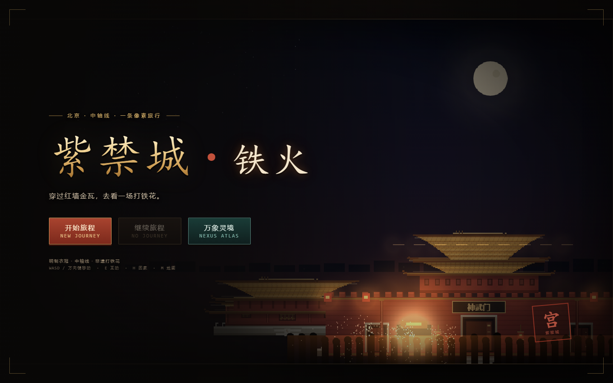 | 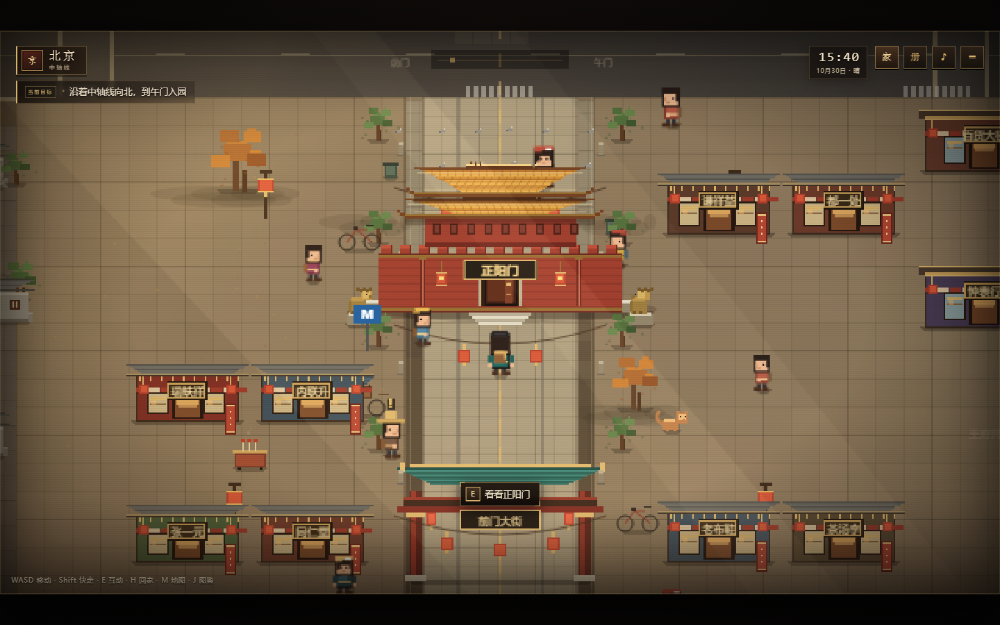 |
| 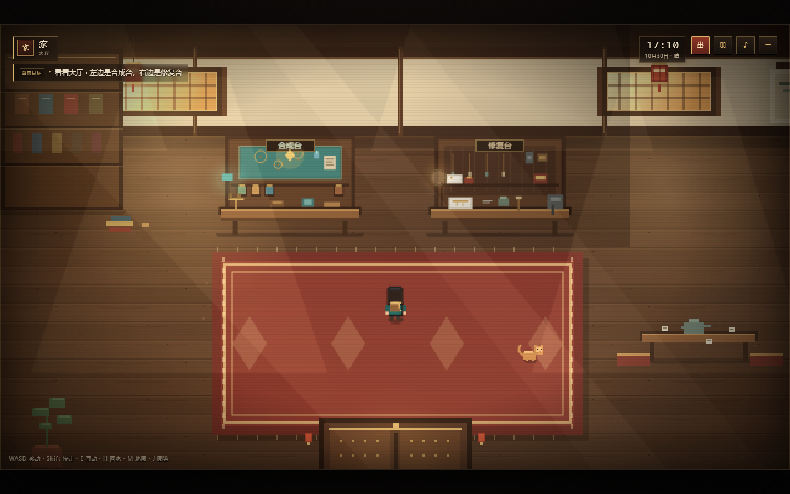 | 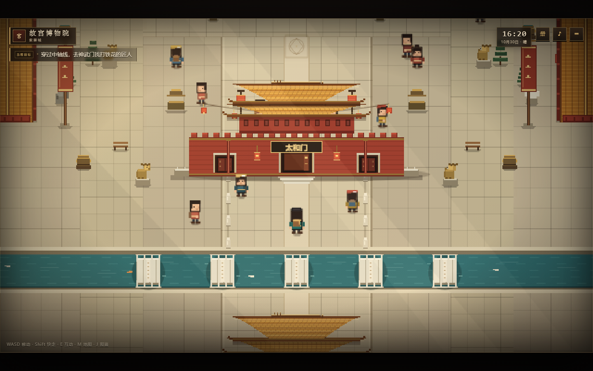 |
| 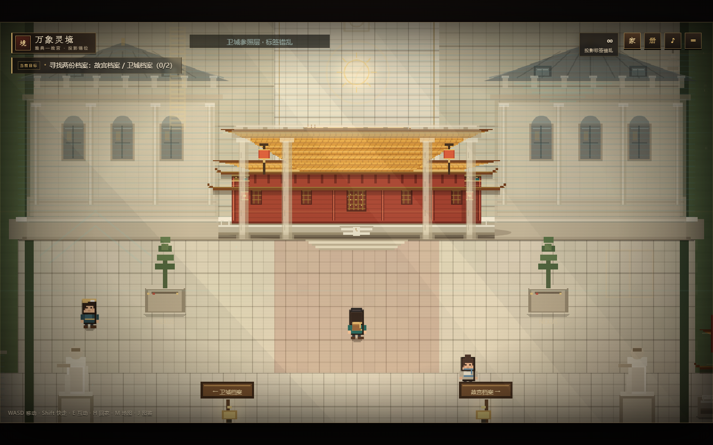 | 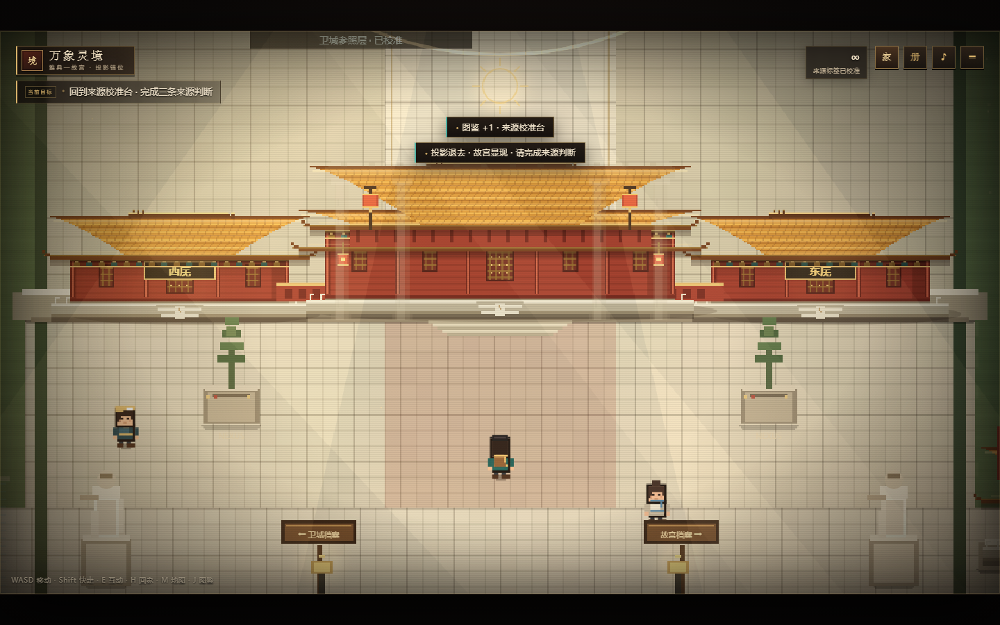 |
| 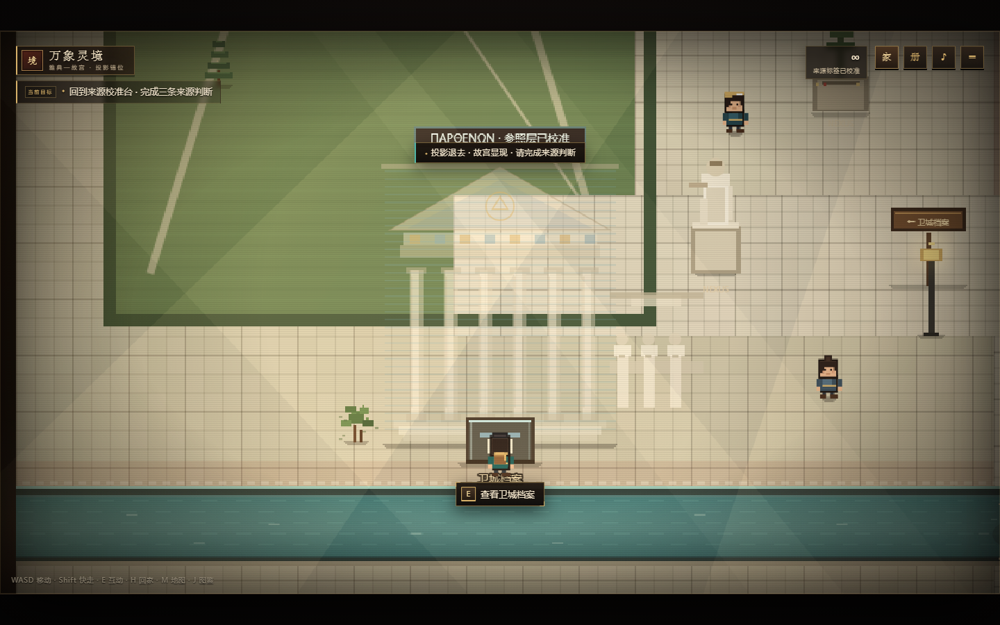 | 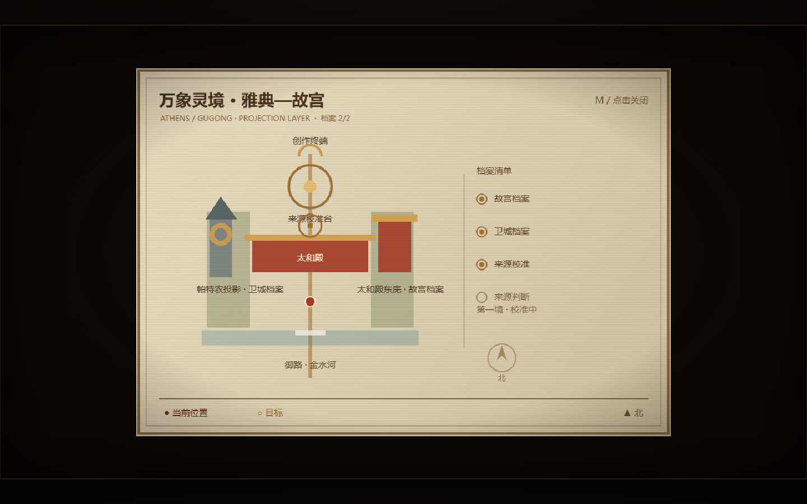 |
| 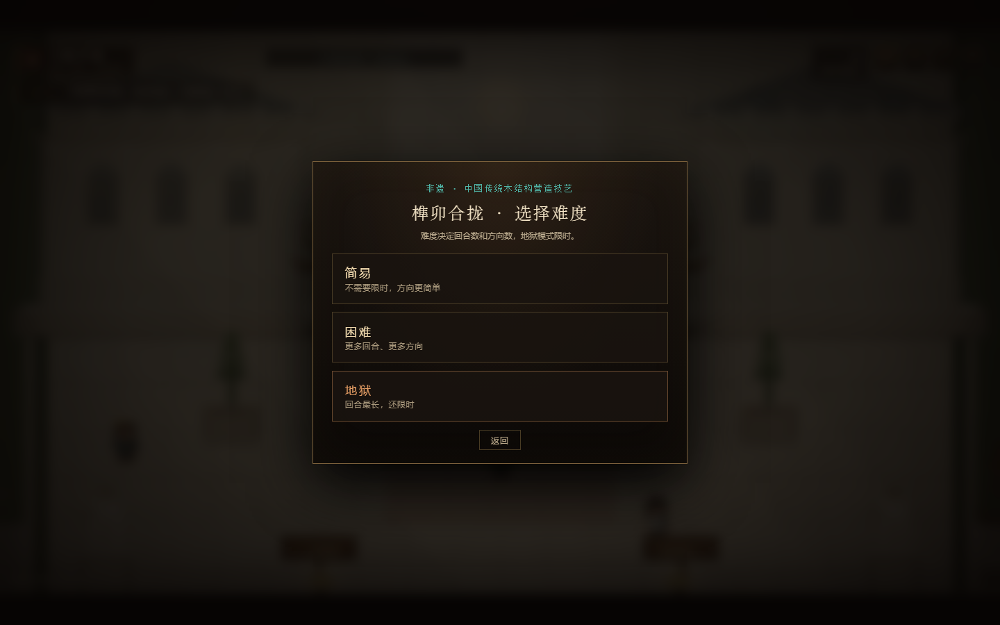 | 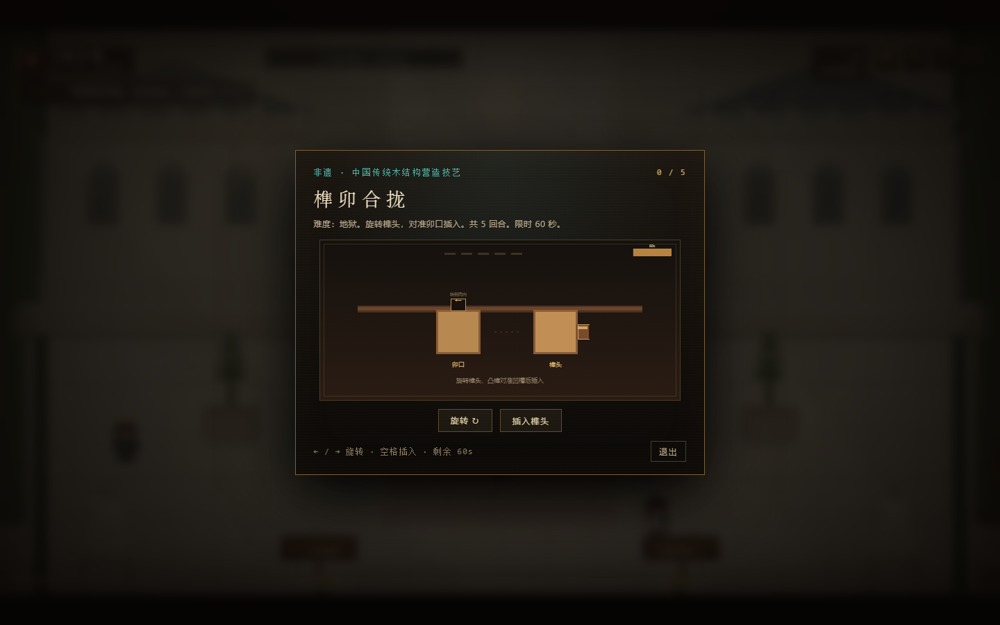 |
| 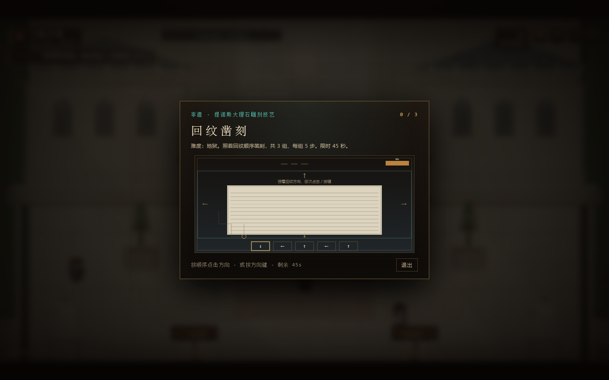 | 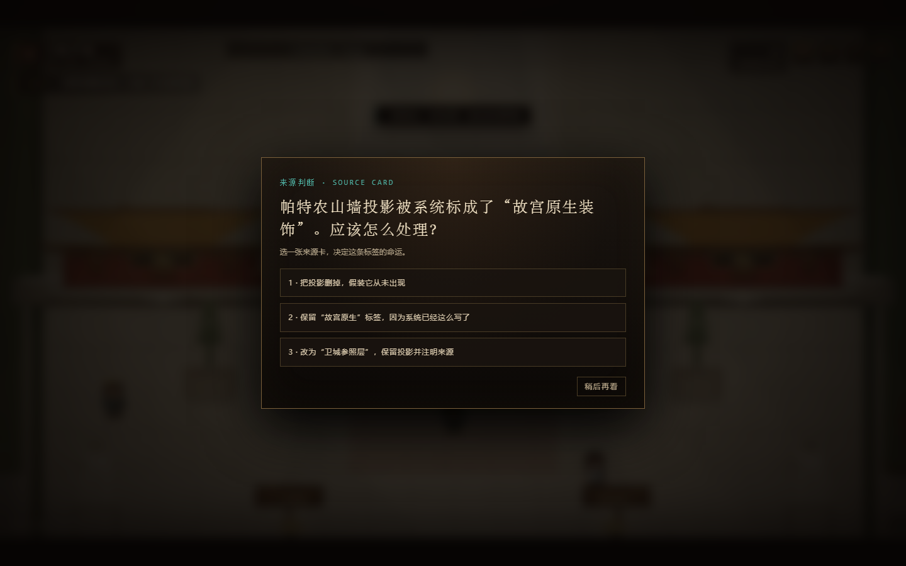 |
| 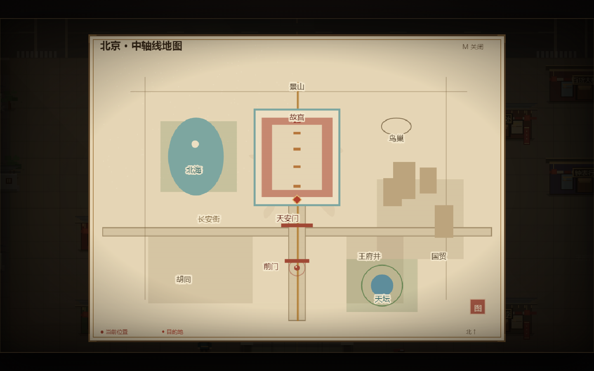 | 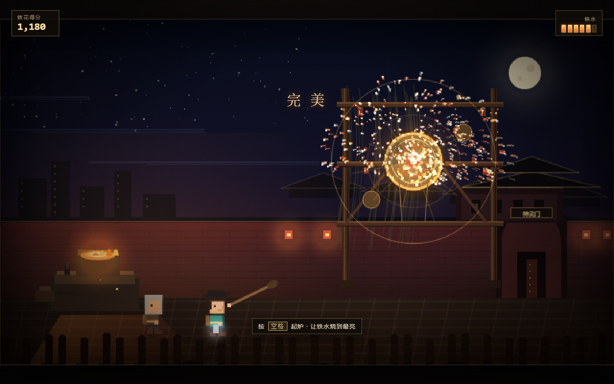 |

---

## 做新地图之前

风格已经固化成一份规范，后面的地图照着它做就不会跑偏：

| 文件 | 作用 |
| --- | --- |
| **[STYLE.md](STYLE.md)** | 美术与地图风格规范：调色板、尺寸表、光照、建筑语法、道具、UI、验收清单 |
| `shots/style-sheet.png` | 视觉样张（一张图看完色板 / 建筑 / 角色 / 道具 / 昼夜） |
| `js/map-template.js` | 可运行的地图模板（城东小院），复制一份改内容即可 |
| `map-bench.html` | 模板预览台，不接主流程也能单独跑一张地图 |

先读 STYLE.md 的第 12 节「新地图制作 SOP」，再打开
`http://127.0.0.1:8123/map-bench.html` 走一圈，就能开工了。

```bash
# 独立预览一张地图（等接入主流程前）
node serve.js
# http://127.0.0.1:8123/map-bench.html
# 参数：?night=1 夜景 · ?map=1 导览图 · ?player=640,470 指定站位
```

---

## 目录

```
index.html            页面、UI 结构、脚本加载顺序（新流程在文件末尾的「六关接线区」）
web.html              单文件网站版（可直接双击打开 / 静态托管）
styles.css            HUD、对话、图鉴等界面
css/cut.css           过场（黑边、卡片、标题）样式
serve.js              本地静态服务器
start.bat             一键启动
data/
  script.json         全部主线文案（$schema wxl.script.v1，唯一文案真源）
  script.js           由 build-data.mjs 生成，供 file:// 与单文件版使用
  maps/*.js           六关卡地图（声明式：ground/props/spots/next）
  cuts/*.js           过场脚本（opening / wumen-intro / ending）
js/
  core.js             输入、对话、音效、存档、粒子、场景管理
  art.js              像素人物、宫殿、城门、道具、夜景绘制
  world.js            俯视世界、相机、碰撞、互动、绘制排序
  str.js              文案读取（带点 id 的路径查找）
  mod.js              模块注册表与 boot()：地图 / 画笔 / 玩法 / 过场
  stage.js            数据驱动关卡场景（G.StageScene）
  cut.js              过场播放器（卡片 / 立绘 / 黑边 / 跳过）
  boot.js             启动入口（最后一个被加载）
  art/wumen.js        午门系画笔（铺地、双网格、门、门额、灯）
  art/halls.js        太和殿 / 乾清宫 / 御花园 / 神武门共用画笔
  mods/*.js           8 个玩法：配准、说明校准、保留选择、承重试验、来源链、反转改判、方案审阅、出门一问
  beijing.js          旧线：北京中轴线地图与地标
  gugong.js           旧线：故宫内部、任务、昼夜
  home.js             旧线：家 · 大厅、合成台与修复台
  fusion.js           旧线：万象灵境 · 雅典—故宫（投影错位地图）
  archive-game.js     旧线：榫卯合拢 / 回纹凿刻非遗小游戏
  difficulty.js       旧线：小游戏难度选择
  source-quiz.js      旧线：三条来源卡判断
  entry.js            旧线：午门入园安检
  minigame.js         旧线：打铁花小游戏
  main.js             旧线：标题、启动、图鉴、菜单
  map-template.js     地图模板：城东小院（旧 WorldScene 写法，新地图见 data/maps/）
athens-city/          雅典 · 卫城（独立游戏，见 athens-city/README.md）
docs/
  模块接口.md         地基 API 契约（写新关卡先读这个）
  关卡设计-v1.0-落地版.md  六关设计定稿
  冲刺4小时.md        排期、砍单线、演示脚本
tools/
  build-data.mjs      data/script.json → data/script.js
  build-web.mjs       → web.html（内联全部样式与脚本）
  check-modules.mjs   静态对账
  smoke.mjs           冒烟测试（真浏览器）
  playthrough.mjs     全链走查（真浏览器）
  test.mjs            旧线的端到端测试（68 条断言）
  shot.mjs            无头浏览器截图
shots/                截图
```

---

## 说明

- 游戏中的入园安检是玩法化演出，不收集、不上传任何个人信息。
- 打铁花为国家级非物质文化遗产，铁水温度可达约 1600°C，现实中的表演有严格的安全防护，请勿模仿。
- 所有像素画面均由 Canvas 实时绘制；字体使用系统中文字体。
- 本项目采用 [MIT 许可证](LICENSE) 开源。

### 考据来源（结尾反转关）

- 故宫博物院藏品页《铜镀金珐琅转花活动人物钟》（故00183132）：<https://www.dpm.org.cn/collection/clock/232081.html>
- 故宫博物院藏品页（该页脚注亦说明「广东钟表的特点多为跑人、水法、转花伴随音乐」）
- 广东省博物馆「清代广钟精品展」相关报道：<http://www.gd.gov.cn/zwgk/zdlyxxgkzl/whjg/content/post_4607463.html>

文案里凡是我们没有核实的内容，都在 `sourceCards[].needsVerify` 里标了 `true`；主题边界（不声称故宫—卫城直接传承、外来构件≠融合）写进了来源卡的 `notClaim` 字段。

---

## 本地运行（命令行）

Windows 双击 `start.bat`；其它系统用：

```bash
node serve.js      # 或 npm start / npm run dev / npm run serve
# 打开 http://127.0.0.1:8123/
```

截图 / 样张由无头 Chrome 生成，命令见 [STYLE.md §17](STYLE.md)。

---

## 合并说明（同步 upstream/main）

本分支已合入 upstream/main 的新内容，与六关主线**互不冲突、各自独立**：

- `#btn-create`「创造模式」→ 旧线 `enterCreate()`；`#btn-exit`「退出游戏」→ `G.exitGame()`（绑定在 `js/main.js:721-723`，按钮已补回标题页）。
- `art-demo/`：队友的 AI 出图 Demo（独立页面 + `serve_ai.py`，不参与主游戏加载）。
- 插件「同境异笔」：独立页面，以 iframe 隔离，不进主线。
- 主线入口仍是标题页的 **「进入万象灵境」**（`#btn-stage` → `G.mod.go('wumen')`），旧线四入口收在「旧线 / LEGACY」折叠区。

验收命令与六关流程不受影响，见上文「验收」一节。
