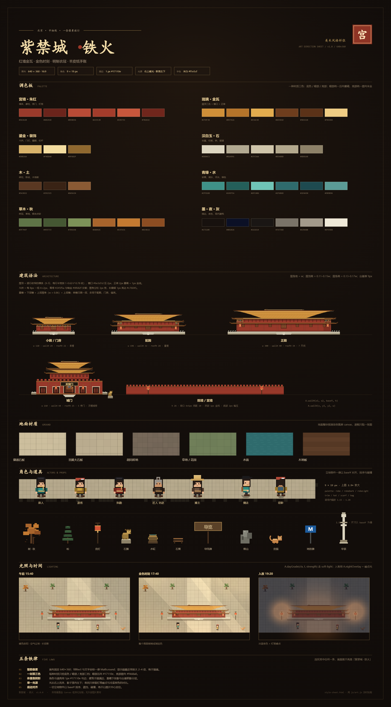
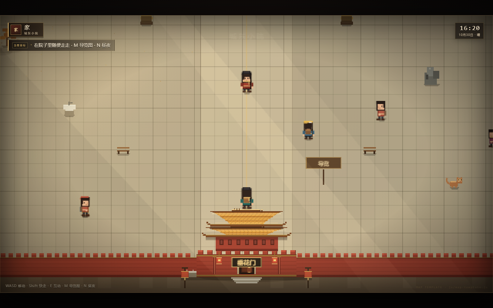
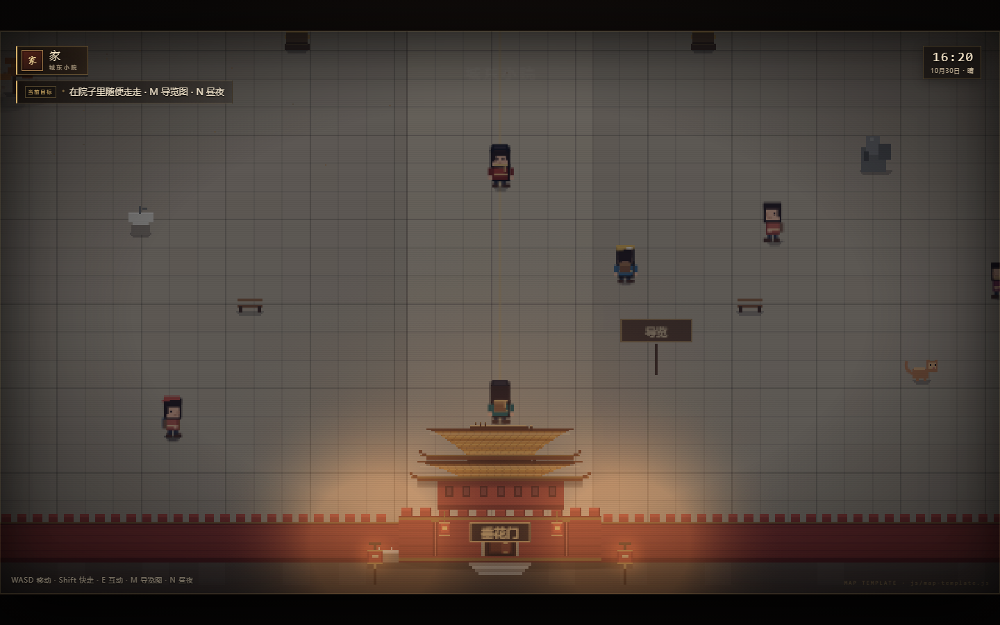
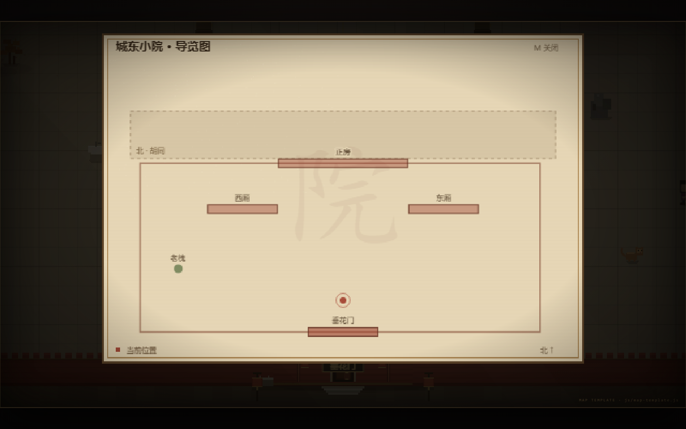

# 紫禁城 · 铁火 — 美术与地图风格规范

> **v1.0 · 640 × 360 俯视像素北京 · 金色时刻的红墙金瓦 · 羊皮纸手账里的旅行**
>
> 这份文档是《紫禁城 · 铁火》的「风格宪法」。后续所有新地图、新场景、新道具，
> 都照这一套做，画面才不会被认成另一个游戏。
>
> 配套文件：
> - 视觉样张 `shots/style-sheet.png`（由 `style-sheet.html` 实时渲染）
> - 可运行的地图模板 `js/map-template.js`
> - 模板预览台 `map-bench.html`（不接主流程也能单独跑一张地图）



---

## 0. 先记住这十个数字

| 项 | 值 | 说明 |
| --- | --- | --- |
| 画布 | **640 × 360** | 16:9，永不改变；显示端最近邻放大 2–4 倍 |
| 角色 | **19 px 高** | 游戏内再缩放到 1.15–1.28 |
| 碰撞盒 | **8 × 5** | 只贴脚底，不是整个精灵 |
| 台基 | **9 px** | 所有殿宇的汉白玉台基统一厚度 |
| 屋顶高 | **0.11–0.15 × 屋身宽** | 屋身高 ≈ 0.13–0.17 × 宽；w < 190 时取固定档 |
| 地砖 | **16 / 18 / 22 px** | 胡同 / 宫廷 / 大殿，三种档位 |
| 宫墙 | **h 26** | 垛口 6×5，每 10px 一个 |
| 灯笼 | **h 26–34** | 夜间光点 r 84–112 |
| 光源 | **右上 → 左下** | 影子一律甩向左手下方 |
| 描边 | **1 px `#17110e`** | 只给角色与前景道具，建筑不描满边 |

---

## 1. 风格定位

三个词：**暖、密、手作**。

| 关键词 | 具体做法 | 反例 |
| --- | --- | --- |
| **暖** | 整体压一层琥珀/金色调（`A.dayGrade`），红墙、金瓦、米白纸面占 80% 的画面 | 冷色霓虹、纯灰水泥、荧光绿草地 |
| **密** | 中景永远有东西：石狮、水缸、灯笼、导览牌、猫、路人；留白只留给天空和广场 | 一大片空铺装，只有主角在走 |
| **手作** | 边缘靠 1px 硬像素与半透明脏迹，不接受渐变糊边；地图做成羊皮纸手账 | 平滑矢量、玻璃拟态、模糊阴影 |

**三个不可混用的参考物**
1. 建筑：明制官式——重檐、斗拱、汉白玉台基、朱红墙身、金琉璃瓦。
2. 生活：北京日常——胡同、老槐、糖葫芦摊、遛弯儿的大爷、宫猫。
3. 材质：纸与铁——羊皮纸、朱印、墨线；夜里是 1600°C 的铁水与冷蓝夜空。

---

## 2. 画布、像素与比例

### 2.1 三条硬规则

1. **一张画布 640×360。** 世界再大也是滚动，不是缩小。
2. **所有坐标 `Math.round()`。** 项目里的 `A.r()` / `G.text()` 已经替你取整，别自己画浮点矩形。
3. **放大只用最近邻。** `#game { image-rendering: pixelated }`，缩放倍率取整数（2/3/4）。

### 2.2 世界尺寸惯例（已有地图）

| 场景 | 世界尺寸 | 出生点 | lookAhead | 说明 |
| --- | --- | --- | --- | --- |
| 北京中轴线 | 2200 × 1500 | 1100, 1200 | 40 | 1 屏宽的尺度感 = 一条街 |
| 故宫 | 1500 × 1620 | 750, 1300 | 52 | 南北纵深，中轴一线 |
| 家 · 大厅 | 960 × 620 | 450, 420 | 60 | 一屏半，室内 |
| 地图模板 · 城东小院 | 1120 × 800 | 560, 650 | 36 | 一进院，1.75 × 2.2 屏 |

**新地图取尺寸的口诀：**

- 一进院子 / 一间屋：**≤ 1.2 屏宽 × 2.2 屏高**（960–1200 × 600–800）
- 一段街区 / 一座宫院：**2–3 屏宽 × 4 屏高**（1300–1900 × 1200–1600）
- 一张大地图（城市级）：**3.5 屏宽 × 4 屏高** 以内（2200 × 1500 已经是上限）

超过这个范围，玩家会失去方向感，而且地面预渲染 canvas 会吃掉内存。

### 2.3 透视

**俯视 3/4 俯角**：看到屋顶、屋身、一点点台基；看不到人脸的仰角。

- 建筑的「底边」= 它站在地上的那条线（`baseY`）。
- 屋顶永远画在屋身上方，向上"长"。
- 纵深靠 **y 排序**（`baseY`），不靠图层。

---

## 3. 调色板

所有颜色都在 `js/art.js` 的 `A.pal` 里。**新地图不要发明新颜色**，缺什么先看能不能用现有的。

### 3.1 核心六组

| 组 | 用途 | 色值 |
| --- | --- | --- |
| 宫墙 · 朱红 | 墙体、廊柱、宫门、灯笼 | `#9a3a2b` `#6b241b` `#b94b36` `#a33c2b` `#c8573c` `#70261c` |
| 琉璃 · 金瓦 | 屋顶三色 + 檐口 + 正脊 | `#cf8f38` `#b5742a` `#e3ac4e` `#6e3d1d` `#5b3218` `#f0cd84` |
| 鎏金 · 装饰 | 斗拱、门钉、匾额、栏杆 | `#d8b26a` `#f4dda0` `#8f682f` |
| 汉白玉 · 石 | 台基、栏板、桥、御道 | `#ddd6c1` `#b2a991` `#cfc5aa` `#b3a88d` `#8d8168` |
| 木 · 土 | 梁柱、陈设、木地板、夯土 | `#5a3822` `#392315` `#8a5a34` |
| 青绿 · 水 | 彩画、湖水、河水、柳色 | `#3f9188` `#245f5a` `#6fc4b6` `#2f6b6d` `#1e4a50` `#5b9b96` |
| 草木 · 秋 | 树冠、草地、银杏 | `#5f7447` `#455733` `#7d9258` `#a8642c` `#c47a31` `#8c4d22` |
| 墨 · 夜 · 灰 | 描边、夜色、现代建筑 | `#17110e` `#0b1026` `#1a1614` `#7a7368` `#a39a8b` `#efe9d8` |

### 3.2 一材质三色

```js
// 对的做法：一个材质只给三档明度
r(c, x, y, w, h, P.wallDark);        // 暗部：结构线、背光面
r(c, x, y + 1, w, h - 2, P.wall);    // 底色：主体
r(c, x + 1, y + 1, 1, h - 4, P.wallLight); // 亮部：一条 1px 高光
```

- 暗部统一压向 `#17110e`（墨），亮部统一提向 `#f4dda0`（米金）。
- 同一个材质**不要**出现第四种色阶；层次靠 `globalAlpha` 的 0.05–0.2 脏迹来做。
- 大面积色块必须叠纹理：`A.paving()` 的砖缝、`A.dither()` 的点、1px 的落叶。

### 3.3 用色的比例

一张截图里，大致是：

- **60% 暖中性**：铺装的米灰、夯土、纸白
- **25% 朱红**：墙、柱、门
- **10% 金 / 黄**：瓦、匾、灯、金线
- **5% 强调**：青绿（彩画、水）、夜色蓝、铁花橙

强调色一旦超过 10%，画面就"花"了。

---

## 4. 光与时间

### 4.1 只有两个时刻

| 时刻 | 做法 | 参数 |
| --- | --- | --- |
| **白天 / 金色时刻** | `A.dayGrade(ctx, t, strength)`，`soft-light` 叠一层从左上暖到右下冷的渐变，再叠两束斜光与地面暖反光 | `strength` 0.5（室内）– 1.7（黄昏） |
| **入夜** | `A.nightOverlay(ctx, cam, lights, α)`：先铺 `rgba(7,12,32,α)`，再用 `lighter` 把每个 `lights` 画成暖色径向光斑 | α 0.5–0.62；光斑 r 84–210 |

模板里的三段对照（`shots/style-sheet.png` 底部）：





### 4.2 影子规则

- 唯一光源在**右上**，所以影子落向**左下**。
- 立地物件用 `A.shadow()`：三行像素的扁椭圆，透明度 0.2–0.32。
- 建筑用**椭圆投影**（`drawHall` / `drawGate` 内部已画 `ellipse(...0.18)`），不要给建筑画 1px 黑边。
- 树影、墙影、檐影用**渐变矩形**，透明度 0.12–0.20：

```js
const g = c.createLinearGradient(x, 0, x + 40, 0);
g.addColorStop(0, 'rgba(50,30,20,.18)');
g.addColorStop(1, 'rgba(50,30,20,0)');
```

### 4.3 空气

- 白天：极淡的尘埃粒子（`life 1.4–2.6`，`size 1`，`rgba(236,220,180,.35)`）。
- 夜里：灯笼附近的高光点，不要满天星。
- 斜光：两束 `globalCompositeOperation = 'lighter'` 的梯形，α 0.04，只画在 `dayGrade` 里。

---

## 5. 建筑语法

所有殿宇都用 `A.drawHall(ctx, x, baseY, w, opts)`，城门用 `A.drawGate(...)`。
**不要手搓建筑**，手搓的檐口一定对不齐。

### 5.1 尺寸档位（照抄这张表）

| 档位 | 宽 w | wallH | roofH | 重檐 | 例子 |
| --- | --- | --- | --- | --- | --- |
| 门房 / 值房 | 92–110 | 22–24 | 20–22 | 否 | 鼓楼下的值房、小院门房 |
| 配殿 / 厢房 | 130–200 | 24–32 | 22–28 | 视等级 | 小院东西厢、箭亭 |
| 正殿 | 236–300 | 34–40 | 28–34 | 是 | 太和殿、乾清宫 |
| 城门 | 130–300 | 30–60 | 22–30 | 是 | 垂花门 130、正阳门 156、天安门 210、午门 244/300 |
| 院墙 | h 22–26 | — | — | — | `A.wallH` / `A.wallV` |


### 5.2 参数表

```js
A.drawHall(ctx, x, baseY, w, {
  wallH: 34,          // 屋身高（0.13–0.17 × w；小房子取 22–26）
  roofH: 30,          // 屋顶高（0.11–0.15 × w；小房子取 20–24）
  double: true,       // 重檐：多出「下层檐 + 上层屋身 + 上层檐」
  name: '正房',        // 匾额（≤ 4 字，7px 金字）
  bays: 5,            // 开间数；不填自动 = max(3, w/38)
  platformPad: 32,    // 台基比屋身每边多出的宽度（20–56）
  stairW: 44,         // 台阶宽
  lanterns: false,    // 檐下灯笼：w ≥ 150 时默认开
  platform: false,    // 不要台基（远景小房子）
});
```

```js
A.drawGate(ctx, x, baseY, w, {
  wallH: 32,          // 城台高
  roofH: 22,          // 城楼屋顶
  double: true,       // 双檐城楼
  arches: 1,          // 券门数：1 / 3 / 5（中间那个最大，是唯一能穿过的）
  name: '垂花门',
  portrait: false,    // 城台上挂不挂画像（天安门用）
});
```

### 5.3 屋顶画法（`art.js` 内部逻辑，改色调时要知道）

1. 从 `baseY` 往上一行一行收窄：`half = w/2 * (1 - 0.62 · t^0.78)`，`t = i / (h-1)`。
2. 第 0–1 行是檐口 `#6e3d1d`；其余按 `i % 5` 在 `roofC / roofA / roofB` 之间跳。
3. 每隔 5px 一根**瓦垄**（深棕 1px）；每隔 4 行压一条 **#ffe0a0 高光**。
4. 檐角要**起翘**：两侧各补 2–3 段 3×2 的阶梯。
5. 正脊：2px `#5b3218` + 1px `#f0cd84`；脊兽 3 只（`ornaments: 3`），每只 1×2。

### 5.4 屋身

- 红墙 + 每 4px 一条 0.13α 的砖缝。
- **立柱**：3px 宽 `wallDark`，右侧 1px `#c76045` 亮边。
- **门窗**：深棕底 `#4a1c15` + `#6b2c20` 面，金线格心每 4px；中央开间加门钉。
- **斗拱**：每 8px 一组 4×2，青绿 `#245f5a` 与暗金 `#8f682f` 交替，上面压 1px 金线。
- **檐下投影**：顶部 14px 的渐变黑，α 0.42 → 0。这是体量的关键。

### 5.5 台基与栏杆

- 台基厚 **9px**：`stoneDark` 底 + `marbleDark` 面 + 顶部 2px `marble` 亮边。
- 栏杆：每 7px 一根 1×4 的望柱，柱头 3×1。
- 台阶：4 级，每级收 2px，明暗交替。
- 御路：中间 6px 宽的雕龙石板，`goldDark` 点两下。

### 5.6 院墙 / 宫墙

```js
A.wallH(ctx, x1, x2, baseY, 26);            // 横墙：垛口 6×5，每 10px 一个
A.wallV(ctx, x, y1, y2, 14);                // 纵墙：每 10px 一道墙帽
```

撞墙的碰撞体**只压 22px 高**，不要按墙的绘制高度算，否则人会卡在墙的"空气"里。

---

## 6. 地面与材质

### 6.1 预渲染

地面**整块**画进一张离屏 canvas，运行时只 `drawImage` 一次可视区域：

```js
this.buildGround((c) => this.paintGround(c));
```

`paintGround(c)` 里按固定顺序叠：

1. 底色（夯土 / 石板 / 木地板）
2. 大块铺装 `A.paving(...)`
3. 甬道 / 主路（亮一档 + 1px 金线）
4. 草地 / 花圃 / 水面
5. 树影、墙影
6. 落叶、石子、裂缝（1px，密度 < 2%）
7. 地面文字（`globalAlpha 0.15`）

### 6.2 `A.paving` 参数

```js
A.paving(c, x, y, w, h, baseColor, altColor, seed, tile);
```

| 场景 | base | alt | tile |
| --- | --- | --- | --- |
| 宫殿大石板 | `#bdaf91` | `#af9f80` | 22 |
| 御道 | `#cdbf9f` | `#bfb090` | 18 |
| 庭院灰砖 | `#b4a789` | `#aa9d80` | 18 |
| 胡同砖地 | `#77695a` | `#66584a` | 16 |
| 草地 / 花圃 | `#71805a` | `#63724f` | 20–22 |

> **base 与 alt 只差一档**。差太多就成了棋盘格，不是石板。

### 6.3 水

`A.water(ctx, x, y, w, h, t, seed)` 会自己画波光；静态河道也可以直接画三层：
`waterDark` 底 → `water` 面 → 顶部 1px `#8fbfb4` 高光 + 底部 1px `#1a3c3f` 暗边。

桥用 `A.bridge(ctx, cx, y, w)`：白石桥面 + 栏板 + 倒影椭圆，宽度 26–32。

---

## 7. 道具与陈设

### 7.1 现成的道具（直接用，别重画）

| 道具 | 调用 | 典型尺寸 / 参数 | 放哪 |
| --- | --- | --- | --- |
| 树（秋冬） | `A.tree(c,x,y,size,{autumn:true})` | size 0.7–1.35 | 院角、街边、墙角后 |
| 松 | `A.pine(c,x,y,size)` | 0.72–1.1 | 宫院、坛庙 |
| 柳 | `A.willow(c,x,y,size,t)` | 1.0 | 水边 |
| 宫灯 | `A.lantern(c,x,y,{h:30,night})` | h 26–34 | 檐下、门两侧、路口 |
| 石狮 | `A.lion(c,x,y,flip)` | 16 宽 × 24 高 | 门两侧，左右翻转 |
| 水缸 | `A.vat(c,x,y,{water:true})` | 16 × 15 | 殿前、院中，成对 |
| 日晷 | `A.sundial(c,x,y)` | 16 × 18 | 宫殿中庭 |
| 铜鹤 | `A.crane(c,x,y)` | 12 × 20 | 大殿两侧，成对 |
| 石凳 | `A.bench(c,x,y)` | 16 × 9 | 树旁 |
| 假山 | `A.rock(c,x,y,s)` | s 0.8–1.2 | 花园角落 |
| 导览牌 | `A.sign(c,x,y,'导览',{w:46,h:15})` | w 34–52 | 路口 |
| 胡同房 | `A.hutong(c,x,y,w,{h:18,tree})` | w 60–160 | 墙后、远景 |
| 宫猫 | `A.cat(c,x,y,t,{color})` | 12 × 14 | 墙角、台阶 |
| 鸽子 | `A.pigeon(c,x,y,t,seed)` | 3 × 4 | 广场，成片 |
| 摊车 | `A.foodCart(c,x,y)` | 22 × 20 | 街边 |

### 7.2 摆放的三条规矩

1. **成对**：石狮、水缸、铜鹤、灯笼一律左右对称，间距 = 殿宽的 0.55–0.75。
2. **贴边**：大件靠墙、靠檐、靠树；中轴只留给导览牌和祭器。
3. **密度**：任意 640×360 视野里，**至少 6 个**可看的东西（含 NPC、灯笼、猫）。
   如果只有主角在走，加两棵树、一对灯笼、一块牌子。

### 7.3 自己画新道具

```js
A.myThing = function (ctx, x, baseY, opt) {
  opt = opt || {};
  A.shadow(ctx, x, baseY, 16, 2, 0.3);      // 1. 先影子
  r(ctx, x - 8, baseY - 4, 16, 4, P.stoneDark);  // 2. 底
  r(ctx, x - 7, baseY - 12, 14, 9, P.wood);      // 3. 体
  r(ctx, x - 7, baseY - 12, 14, 1, P.gold);      // 4. 顶亮边
  // 5. 只加 1–2 个细节，不要花纹
};
```

规则：**先影子，再底，再体，再一条亮边，最后最多两个细节。**

---

## 8. 角色与 NPC

### 8.1 结构

- 正面 13 × 19 px：头 10 × 10、身 8 × 8、腿 2 + 2、鞋。
- 侧面 / 背面由同一个函数翻面与换细节，不需要另画一套。
- 走路两帧：`frame 1` 前后腿错开，`frame 2` 反向；站立时 ±1px 呼吸。

```js
A.drawActor(ctx, x, y, {
  dir: 'down' | 'up' | 'left' | 'right',
  frame: 0 | 1 | 2,
  moving: false,
  time: this.time,          // 呼吸用
  palette: A.actorPalettes.player,
  accessory: 'spear' | 'ladle' | 'broom',
  scale: 1.26,
});
```

### 8.2 配色槽

每个角色只需要 6–8 个槽：

```js
{ robe, robeDark, robeLight, trim, pants, shoe, skin, skinShade, hair, hat, hatType, scarf, bag }
```

现成的：`player`（旅人，青绿+金）、`guard`（执勤，朱红）、`zhao`（老赵，泥褐+灰发）、
`tourist` / `tourist2` / `auntie` / `child` / `vendor` / `worker` / `guide`。

新 NPC 从这十个里挑一个改 `hatType` 和 `trim` 就够，**不要造第 11 套主色**。

### 8.3 缩放与名字

| 场合 | scale |
| --- | --- |
| 世界里的主角 | 1.28 |
| 世界里的 NPC | 1.26 |
| 纯装饰路人 | 1.15 |
| 小游戏 / 特写 | 1.3+ |

- 名字牌：距离 < 56px 时在头顶 34px 处显示，8px `#f0dfc0`，描 3px 黑边。
- 任务 NPC 头顶一颗 `!`（8px 金色，带 5×7 的半透明底）。

---

## 9. 可读性三件套

玩家永远要知道：**这是什么、我能不能互动、下一步去哪。**

| 元素 | 做法 |
| --- | --- |
| **热点提示** | 距离 < `r`（通常 26–52）时，屏幕下方弹 `<kbd>E</kbd> + 动词短语`，如「推开正房的门」 |
| **目标浮标** | `this.marker = {x, y}`，金色菱形上下浮动 3px，外加 10px 的呼吸光圈 |
| **对话** | 名字牌 + 逐字打字（22ms/字），叙事段落用 `narrator: true`（楷体、无名字牌） |

### 9.1 文案语气

- 陈述句、短句、具体的名词。**不写"你感到很好"，写"窗纸把光滤成蜜色"。**
- 每个交互 1–2 句，最多 3 句。
- 旁白（手账）用第一人称；建筑解说用第三人称；动物用括号写动作。

```js
G.dialog.show([
  { name: '旅行手账', narrator: true, text: '一座普通的北京小院。灰砖、红门、两棵老槐。' },
  { name: '宫猫', text: '（尾巴尖动了一下，懒得睁眼。）' },
]);
```

---

## 10. UI / HUD

| 元素 | 规格 |
| --- | --- |
| HUD 底色 | `rgba(21,15,11,.94) → rgba(34,24,17,.82)` 渐变 + `1px rgba(216,178,106,.38)` 边 |
| 强调边 | 左侧 2px `#d8b26a` 竖条 |
| 地点章 | 2.15em 方框，`#7b2b1e` 渐变底 + 金边 + 楷体单字（京 / 宫 / 家） |
| 目标条 | 金色小菱形 ◆ + 正文 0.92em |
| 时间 | 等宽字体 `Consolas`，1.38em，`#f4e4c8` |
| 按钮 | 2.45em 方形，金字符（家 / 册 / ♪ / ≡） |
| 对话框 | 深棕渐变 + 金边 + 四角 12px 的 1px 直角括号；名字牌压在左上角 |
| 过场字卡 | 楷体 `clamp(22px, 3.4vw, 54px)`，字距 0.28em，上下各一条渐隐金线 |
| 字体 | 标题/人名：`KaiTi`；正文：`Microsoft YaHei`；数字/键位：`Consolas` |

**UI 不抢画面**：所有 UI 面板必须半透明（0.82–0.98），并且带 `backdrop-filter: blur(4px)`。

---

## 11. 羊皮纸地图

M 键打开的导览图，是"旅行手账"的人格化体现，也是新地图必须补的一张图。



### 11.1 参数

```js
const mx = 110, my = 34, mw = 420, mh = 262;   // 纸面在 640×360 里的位置
const X = (wx) => mx + (wx / this.w) * mw;     // 世界坐标 → 纸面坐标
const Y = (wy) => my + (wy / this.h) * mh;
```

| 层 | 做法 |
| --- | --- |
| 暗幕 | `rgba(10,8,6,.84)` 铺满 |
| 纸 | `#e9d9b8`，外扩 14 / 22 |
| 纸纹 | 150 个 1px 点，`#a68b5f` / `#fff5dd` 各半，α 0.2 |
| 框 | 外 2px `#5f4529`，内 1px `#b08a55`，内缩 5px |
| 标题 | 11px 粗体 `#3d2d1c`，左上角；「M 关闭」7px 右上角 |
| 水印 | 一个大篆字（院 / 京 / 宫），120px，α 0.05，朱红 |
| 建筑 | 朱红半透明矩形（α 0.38），门用 0.55；1px 深棕描边 |
| 树 | 4px 绿点 |
| 当前 | 3px 红点 + 呼吸圈 |
| 图例 | 左下「当前位置」，右下「北 ↑」 |

### 11.2 规矩

- 地图是**示意图**，不是等比俯视图：建筑画成条块，不画屋顶。
- 只标 5–8 个地标，多了就糊。
- 一定画围墙轮廓（1.5px 朱红），玩家靠它认方向。

---

## 12. 新地图制作 SOP

### 第 0 步：先想清楚三件事

1. 这是**哪**（地名 + 一句话气质）
2. 玩家来这**干什么**（一条目标，能一句话说完）
3. 走完一圈要**多久**（30 秒？3 分钟？决定世界尺寸）

### 第 1 步：复制模板

```bash
cp js/map-template.js js/yourmap.js
```

改四处：`id`、`w/h`、`spawn`、`title`。然后打开 `map-bench.html`（见 12.4）先跑起来。

### 第 2 步：铺地

写 `paintGround(c)`，按第 6 节的 7 层顺序。**先只有底色和铺装**，把路走通。

### 第 3 步：立墙、放建筑

从大到小：院墙 → 正殿 → 配殿 → 门。每放一个立刻补 `this.solid()` / `this.solidRect()`。

```js
this.addBuilding(x, baseY, (c) => A.drawHall(c, x, baseY, w, {...}));
this.solidRect(x, baseY, w + 2, 26);   // 只挡屋身那一条
```

### 第 4 步：摆道具

按第 7 节的密度要求，把中景填满。成对的东西用 `for (const x of [a, b])`。

### 第 5 步：接交互

每个可互动的东西都要 `label`（动词短语）和 `action`（对话 / 切换场景 / 给道具）。
至少放 1 个 NPC 和 1 个地标级交互。

### 第 6 步：写 HUD 与目标

```js
onEnter() {
  G.ui.location('家', '城东小院');
  this.objective('在院子里随便走走');
  this.updateHud();
}
```

### 第 7 步：昼夜 + 地图

- 加 `this.addLight()`（灯笼处），夜里就有光斑。
- 写 `drawMap()`，地标塞进 `this.landmarks`。

### 12.4 独立预览台（重要）

`map-bench.html` 是一个**不接主流程**的启动器：只加载 `core / art / world / 你的地图`，
用一个最小循环跑你的场景。新增地图时先在这里调，调好再接进 `index.html` 和剧情。

```
http://127.0.0.1:8123/map-bench.html            // 正常游玩
http://127.0.0.1:8123/map-bench.html?night=1    // 直接看夜景
http://127.0.0.1:8123/map-bench.html?map=1      // 直接看导览图
http://127.0.0.1:8123/map-bench.html?player=640,470&nodlg=1
```

（截图脚本也是靠这几个参数出图的。）

### 12.5 接进游戏

1. `index.html` 里在 `main.js` 之前加 `<script src="js/yourmap.js"></script>`。
2. 在触发点（某个门、某个 NPC）里：

```js
G.fade.to(() => G.setScene(new G.YourScene(), { spawn: { x: 640, y: 700 } }));
```

3. 存档：新场景的进度用 `G.save.flag('yourFlag')`，不要直接改 `G.save.data` 以外的东西。

---

## 13. 工程与性能约束

| 约束 | 数值 / 做法 |
| --- | --- |
| 地面 | 世界尺寸的一张离屏 canvas；不要每帧重画 |
| 建筑精灵 | `A.hallSprite` / `A.gateSprite` 内部有 `spriteCache`，同参数只画一次 |
| 粒子 | 上限 1400；`G.fx.add` 自动裁剪 |
| 碰撞 | 只遍历 `this.solids` 的矩形，盒 8×5 |
| 排序 | 每帧 `entities.sort((a,b) => a.baseY - b.baseY)`；只排可视区 |
| 视野裁剪 | `baseY` 超出 `cam.y - 240 ~ cam.y + H + 180` 的实体跳过绘制 |
| 音频 | 全部用 `G.audio` 的合成音，不加载音频文件 |
| 资源 | **零外部图片**，所有画面 Canvas 程序化绘制 |

---

## 14. 验收清单

新地图做完，逐条打勾：

- [ ] 画布仍是 640×360，没有出现半像素/模糊边
- [ ] 所有立地物件用 `baseY` 对齐，人物能正确地被建筑遮挡
- [ ] 建筑只挡屋身那一条，人能走到屋檐下
- [ ] 任意一屏里至少 6 个可看物件（含 NPC / 灯笼 / 猫）
- [ ] 影子全部朝左下，没有第二个光源
- [ ] 颜色全部来自 `A.pal`，没有新造的荧光色
- [ ] 地面 base 与 alt 只差一档，没有棋盘格
- [ ] 每个交互都有动词短语，且 `r` 足够（26–52）
- [ ] `M` 能开出羊皮纸地图，玩家点在正确位置
- [ ] `N` 或剧情切夜后，灯笼有光斑、整体压冷蓝
- [ ] HUD 的地点章字对（京 / 宫 / 家）
- [ ] 目标文案 ≤ 20 字，能一句话说清
- [ ] 存档 flag 有前缀，不会跟别的地图打架

---

## 15. 反例：这些事不要做

1. 给建筑描 1px 黑边（会变成"贴纸"，失去体量）。
2. 用纯黑 `#000` 做阴影（要用 `rgba(10,7,5,α)` 的暖黑）。
3. 角色用 4 倍缩放画进世界（角色是 19px 的小人，不是 Q 版）。
4. 地面画棋盘格、草地画纯绿。
5. 一屏放 30 个道具（会糊成一锅粥，密度 6–12 个刚好）。
6. 用渐变做 UI 圆角（UI 是直角 + 1px 金边）。
7. 在大地图里让相机不加 `lookAhead`（玩家会一直贴屏幕下沿）。
8. 夜晚铺纯蓝（要用 `rgba(7,12,32,α)` + 暖色光斑对撞）。
9. 给 NPC 起"商人""村民"这种通用名（要起"院主""摄影的""王大爷"）。
10. 在 `paintGround` 里画会动的东西（地面是静态缓存）。

---

## 16. 附录：文件结构

```
forbidden-city/
  index.html          页面与 UI 结构（HUD / 对话 / 安检 / 图鉴 / 结算）
  styles.css          UI 样式（色值变量在 :root）
  serve.js            本地静态服务器（8123）
  style-sheet.html    ★ 风格样张（用 art.js 实时绘制）
  map-bench.html      ★ 地图模板预览台
  js/
    core.js           输入、对话、音效、存档、粒子、场景切换、文字绘制
    art.js            ★ 全部像素画：调色板、角色、殿宇、城门、道具、昼夜
    world.js          俯视世界基类：相机、碰撞、排序、交互、HUD
    beijing.js        北京中轴线（2200×1500）
    gugong.js         故宫内部（1500×1620）
    home.js           家 · 大厅（960×620）
    entry.js          午门入园安检（演出）
    minigame.js       打铁花小游戏
    main.js           标题、启动、图鉴、菜单
    map-template.js   ★ 地图模板（1120×800）
  shots/              截图
```

**扩展点，按优先级：**

1. `art.js` 里加新道具（`A.xxx = function(ctx, x, baseY, opt){}`）
2. `art.js` 里加新角色配色（`A.actorPalettes.xxx = {...}`）
3. 新建 `js/xxx.js` 继承 `G.WorldScene`
4. `core.js` 里加新音效 / 新 UI 提示

---

## 17. 重新生成样张

样张是代码画的，改了 `art.js` 之后重新截一次就行：

```powershell
& "C:\Program Files\Google\Chrome\Application\chrome.exe" `
  --headless=new --disable-gpu --hide-scrollbars `
  --force-device-scale-factor=2 --window-size=1240,2240 `
  --virtual-time-budget=5000 `
  --screenshot="shots\style-sheet.png" `
  "file:///.../forbidden-city/style-sheet.html"
```

模板截图同理，把 URL 换成 `map-bench.html?player=560,690&nodlg=1` 等参数即可。

---

*最后一条：风格不是限制，是让第 20 张地图和第 1 张地图看起来像同一个人做的。*
