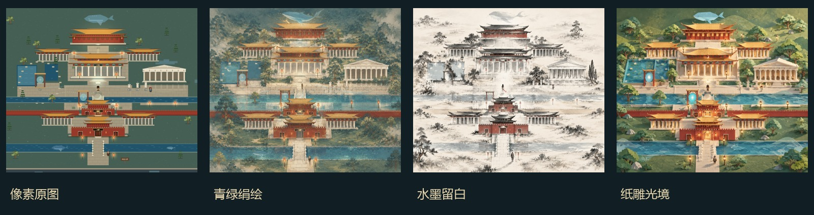
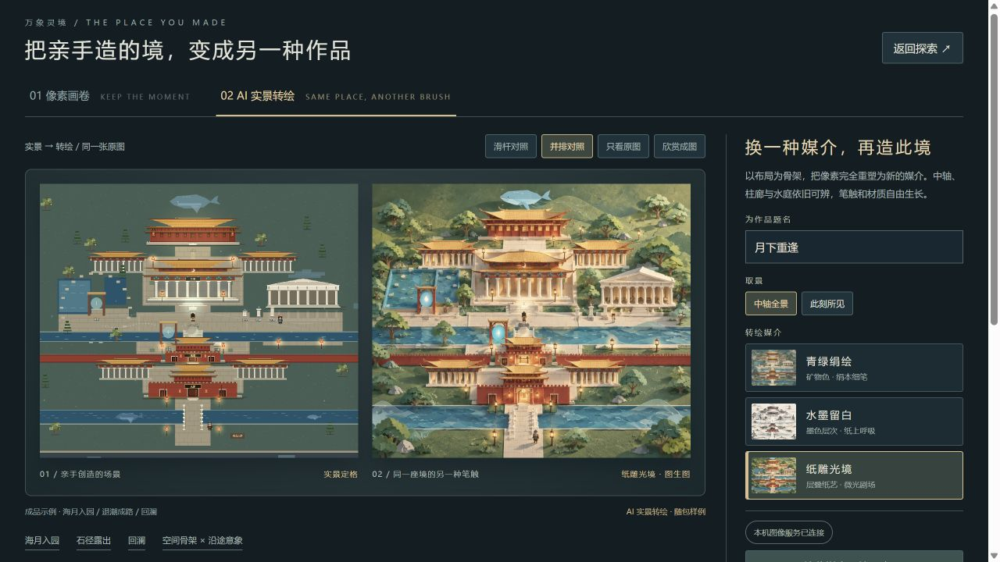

# 万象灵境 · 同境异笔

**把你探索和创造的像素场景，变成可以收藏的非像素画作。**

黑客松演示版本 `v0.5-art.1`：像素探索、节点互动、场景创作，以及基于实际场景截图的三种转绘媒介——青绿绢绘、水墨留白、纸雕光境。



## 队友最快试玩

1. 点击仓库上方 **Code → Download ZIP**，完整解压。也可下载 [Releases](../../releases) 中的离线试玩包。
2. 双击 `index.html`（Windows 也可双击 `启动离线试玩.bat`），推荐桌面 Chrome / Edge。
3. 首页点击 **先看成品**，即可切换三种媒介、查看滑杆对照、放大赏画、题名并下载收藏展签。

离线试玩不需要 Node.js、Python、账号或 API。`index.html` 是自带全部代码和三张成图样例的完整单文件，可以单独转发。**GitHub 的文件预览不是游戏页面，请下载后打开。**

需要在页面内调用 Image 为新场景转绘，请下载 Release 的 `*-full.zip` 或完整仓库，先读 [Image接入-队友先读.md](Image接入-队友先读.md)。完整包包含本机后端，但仍需自己的 Python、imagegen CLI、SDK 与认证；不是解压后零配置生成。



## 自己探索与成画

返回探索或创作，使用 WASD / 方向键移动、E 互动、Shift 快走、J 手记、P 打开作品页。手机可浏览作品页，探索操作仍面向键盘。

固定成品场景自带三张真实 AI 转绘样例。修改场景或切换取景后，需要为新的原图生成结果，不能用样例冒充。在线生成操作见 [启动.md](启动.md)，外部处理后也可导入结果。

在线 AI 服务仅在本机运行，需 Python 3.11+、自己的认证及图片工具依赖；不会随离线页面或 GitHub 自动获得。生成可能计费，失败不自动重试。新生成/导入的图片仅在页面会话缓存，关闭前请下载。

## 开发与协作

安装 Node.js 22+ 后，在仓库根目录运行：

```sh
node build.js
node verify.cjs
```

不需要 `npm install`。必要原型绘制代码已收进 `vendor/`，构建不依赖其他目录。`src/` 为源码，`assets/` 为真实样例与绑定记录，`index.html` 为可直接交付的构建产物。

- [交互与复用契约](docs/交互.md)：场景与进度分离、成图绑定、接口及队友操作。
- [图片工具配置](tools/image-api/README.md)：在线服务的可选配置。
- [改进说明](改进说明.md)：本版设计、已完成检查和边界。
- [素材与生成说明](docs/素材与生成说明.md)：代码与样例来源。
- [GitHub 发布与更新](docs/GitHub发布.md)：认证、检查、提交和分享流程。

本仓库为独立演示快照，WorldSpec v3；其他开发线如 v0.6 应按接口迁移，避免整文件覆盖。当前场景生成是规则与预设组合，AI 画作也不代表精确建筑复原。本版暂不包含视频。
